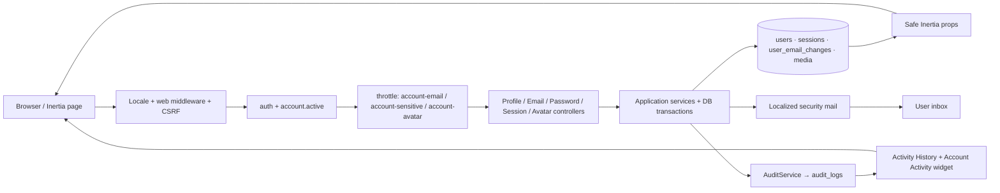

# Account Management Architecture

> **Status:** Design contract documentation for Implementation Wave 2. It describes the agreed target behavior; it is **not** a claim that the implementation is deployed or verified. Verification status is tracked in [TESTING_REPORT.md](TESTING_REPORT.md).

---

## 1. Scope and key decisions

| Area | Contract decision |
|---|---|
| Authentication | Laravel 13.43 **session guard only** (`web` guard, Eloquent user provider). No Sanctum, no API tokens, no second guard. |
| Session storage | `database` session driver. The `sessions` table gains an opaque `public_reference`; the raw session ID is never exposed. |
| Account surface | Localized Inertia page `Account/Profile/Show` at `/{locale}/dashboard/profile` for `ar` and `en`. |
| Protection | Every endpoint requires `auth` + `account.active`. `signed` is additive on email confirmation and avatar download — signed links are **not** public. |
| Data ownership | All reads and writes are scoped to `Auth::id()`. References are opaque identifiers, never proof of authorization. |
| Audit | All meaningful changes are recorded through `AuditService` using `auth.`, `account.`, `profile.`, `user.` prefixes. |
| UI | Reuse the existing dashboard layout and `Ui/` components; no new design system. |
| Localization | Full bilingual EN/AR coverage with RTL/LTR direction handling. |

Detailed behavior lives in [Profile Management](PROFILE_MANAGEMENT.md), [Session Management](SESSION_MANAGEMENT.md), [Activity Tracking](ACTIVITY_TRACKING.md), and [Security Review](SECURITY_REVIEW.md).

---

## 2. Component map



**Layering rules**

1. Controllers accept Form Requests only; no `request()->all()` into models.
2. Services own invariants (token consumption, session revocation, file cleanup) inside database transactions.
3. Audit entries are written after the state change succeeds, so rolled-back operations leave no audit record.
4. Only allowlisted, safe fields are serialized into Inertia props.

---

## 3. Database changes

| Table / column | Change | Type / constraint | Purpose |
|---|---|---|---|
| `sessions.public_reference` | Added | 32-character hex string, `unique`, `nullable` | Opaque handle for listing/revoking sessions without exposing the raw session ID. |
| `sessions.created_at` | Added | `timestamp`, nullable | Session start time for the Connected Devices view. |
| `user_email_changes` | New table | `user_id` FK, `new_email`, `token_hash`, `expires_at`, timestamps | Pending email change with a hashed, single-use token and 60-minute expiry. |
| `users.avatar_media_id` | Added | Nullable FK to `media` | Profile photo backed by a **private** Media row (`is_restricted = true`). |
| `users.last_activity_at` | Added | Nullable `timestamp` | Throttled (60s) "last seen" value used by the dashboard widget. |
| `users.last_login_at` | Existing | Unchanged | Still the authoritative last successful login time. |

Contract-level schema sketch (illustrative only — implementation migrations are authoritative):

```sql
ALTER TABLE sessions
  ADD public_reference CHAR(32) NULL UNIQUE,
  ADD created_at TIMESTAMP NULL;

CREATE TABLE user_email_changes (
  id BIGINT UNSIGNED AUTO_INCREMENT PRIMARY KEY,
  user_id BIGINT UNSIGNED NOT NULL,
  new_email VARCHAR(255) NOT NULL,
  token_hash VARCHAR(64) NOT NULL,            -- hashed, single-use
  expires_at TIMESTAMP NOT NULL,              -- requested_at + 60 minutes
  created_at TIMESTAMP NULL,
  INDEX (user_id),
  UNIQUE (token_hash)
);

ALTER TABLE users
  ADD avatar_media_id BIGINT UNSIGNED NULL,   -- private Media, is_restricted = true
  ADD last_activity_at TIMESTAMP NULL;        -- throttled write, 60s

-- users.last_login_at already exists and is not modified.
```

The raw session ID (`sessions.id`) is server-only. It must not appear in props, URLs, audit context, notifications, or logs. See [Session Management](SESSION_MANAGEMENT.md) §2.

---

## 4. Routes and endpoints

All routes are localized under `/{locale}/dashboard/profile` (`locale` constrained to `ar|en`) and sit inside the authenticated, active-account dashboard group. Exact registered names can be confirmed with `php artisan route:list --name=account` after implementation.

| Method | URI suffix | Contract route name | Additional middleware | Purpose |
|---|---|---|---|---|
| `GET` | `/` | `account.profile.show` | — | Render `Account/Profile/Show` with all sections. |
| `PUT`/`PATCH` | `/` | `account.profile.update` | `throttle:account-sensitive` | Update personal information. |
| `POST` | `/email` | `account.email.request` | `throttle:account-email` | Start a pending email change. |
| `DELETE` | `/email` | `account.email.cancel` | `throttle:account-email` | Cancel the pending change. |
| `GET` | `/email/confirm/{token}` | `account.email.confirm` | `signed`, `throttle:account-email` | Confirm with hashed single-use token; still requires `auth`. |
| `PUT`/`PATCH` | `/password` | `account.password.update` | `throttle:account-sensitive` | Change password. |
| `GET` | `/sessions` | `account.sessions.index` | — | List active sessions via `public_reference`. |
| `DELETE` | `/sessions/{session:public_reference}` | `account.sessions.destroy` | `throttle:account-sensitive` | Revoke one owned session. |
| `DELETE` | `/sessions` | `account.sessions.destroy-others` | `throttle:account-sensitive` | Revoke all other sessions; preserve current. |
| `POST` | `/avatar` | `account.avatar.store` | `throttle:account-avatar` | Upload/replace profile photo. |
| `DELETE` | `/avatar` | `account.avatar.destroy` | `throttle:account-avatar` | Remove profile photo. |
| `GET` | `/avatar/{media}/download` | `account.avatar.download` | `signed` | 30-minute private download; still requires `auth` + ownership check. |

**Middleware notes**

- `auth` and `account.active` apply to every route above, including the two signed routes. Signing proves URL integrity; it does not authenticate a user.
- `web` middleware (sessions, CSRF, cookies) applies to all state-changing routes.
- Signed URLs are time-limited and generated server-side with `URL::temporarySignedRoute()`.

---

## 5. Middleware pipeline

```text
web (cookie, session, CSRF)
  → SetLocale / locale prefix
  → auth
  → account.active
  → route-specific throttle (account-email | account-sensitive | account-avatar)
  → FormRequest validation / signed check where applicable
  → controller → service → audit
```

| Middleware | Role in account management |
|---|---|
| `auth` | Rejects guests; establishes `Auth::id()` as the ownership key. |
| `account.active` | Rejects inactive/suspended/locked accounts even with a valid session. |
| `signed` | Validates HMAC and expiry for email confirmation and avatar download; additive to `auth`. |
| `throttle:account-*` | Applies the limiter named in §7. |
| Last-activity throttle | Writes `users.last_activity_at` at most once per 60 seconds (see [Activity Tracking](ACTIVITY_TRACKING.md) §4). |

---

## 6. Services and invariants

| Service area | Invariant | Audit event(s) |
|---|---|---|
| Profile update | Only allowlisted personal fields change; email changes go through the confirmation flow. | `account.profile.updated` |
| Email change | One pending change per user; token hashed, single-use, 60-minute expiry; old address stays active until confirmation. | `account.email_change.requested` / `confirmed` / `cancelled` |
| Password change | Current password verified; `Password::min(12)` + `confirmed`; other sessions revoked; remember token rotated. | `account.password.changed` |
| Session management | Queries scoped to `user_id = Auth::id()`; only `public_reference` is used publicly. | `account.session.revoked` / `account.sessions.revoked` |
| Avatar management | Private storage, restricted Media row, validated type/size/content, ULID filename, old file cleaned up when unused. | `account.avatar.uploaded` / `account.avatar.removed` |
| Activity | Safe-field projection, IP masking, UA-derived device labels, no secret material. | `auth.*` plus `account.*` events |

Cross-cutting rules:

- **Atomicity:** email confirmation and password change revoke sessions and rotate the remember token in the same transaction as the primary update.
- **Single-use tokens:** the email-change token is stored hashed and consumed by deletion/invalidation inside a transaction so a replay cannot confirm twice.
- **Fail closed:** invalid signature, wrong owner, expired token, or unknown `public_reference` yields a generic not-found/forbidden response without data leakage.

---

## 7. Rate limiters

| Limiter | Threshold | Applied to |
|---|---|---|
| `account-email` | 3 requests / minute | Email request, cancel, confirm. |
| `account-sensitive` | 5 requests / minute | Profile update, password update, session revocation endpoints. |
| `account-avatar` | 10 requests / minute **and** 30 requests / hour | Avatar store, destroy (and download if route-level throttling is enabled). |

Keys combine authenticated user identity and request IP where appropriate; see [Security Review](SECURITY_REVIEW.md) §5.

---

## 8. Frontend contract

- **Page:** `resources/js/Pages/Account/Profile/Show.vue` rendered by `account.profile.show`.
- **Sections:** Overview, Personal Information, Profile Photo, **Security (`#security` anchor)**, Connected Devices, Activity History.
- **Reuse:** existing dashboard layout, navigation, and `Ui/` primitives; Inertia forms for mutations.
- **Dashboard widget:** "Account Activity" on the existing dashboard showing real last activity (`users.last_activity_at`), last login (`users.last_login_at`), active session count, security status, and links into the profile sections including `#security`. No placeholder values.
- **Localization:** every label, validation message, and notification key exists in both `lang/en` and `lang/ar`; layout switches LTR/RTL with the locale.

---

## 9. Localization and retention summary

- Security mail for email changes is localized to the user's `locale` with a code-owned fallback; it is critical delivery and is never skipped for a missing database translation.
- Session rows follow framework session garbage collection; revoked rows are deleted immediately.
- Pending email-change rows expire after 60 minutes and are pruned; consumed/cancelled tokens are deleted.
- Activity history reads existing audit logs subject to the application's audit retention/archive policy; no separate indefinite log is introduced.

Full rules: [Activity Tracking](ACTIVITY_TRACKING.md) §7 and [Security Review](SECURITY_REVIEW.md) §8.

---

## 10. Document index

| Document | Covers |
|---|---|
| [Account Management Architecture](ACCOUNT_MANAGEMENT_ARCHITECTURE.md) | Schema, routes, middleware, services, audit catalog, rate limiters. |
| [Profile Management](PROFILE_MANAGEMENT.md) | Personal data, email change, password, avatar. |
| [Session Management](SESSION_MANAGEMENT.md) | Session identity, device list, revocation, remember tokens. |
| [Activity Tracking](ACTIVITY_TRACKING.md) | Audit events, masking, device derivation, last activity, retention. |
| [Security Review](SECURITY_REVIEW.md) | Threats, controls, authorization matrix, residual risks. |
| [Testing Report](TESTING_REPORT.md) | Pending verification matrix and commands. |
